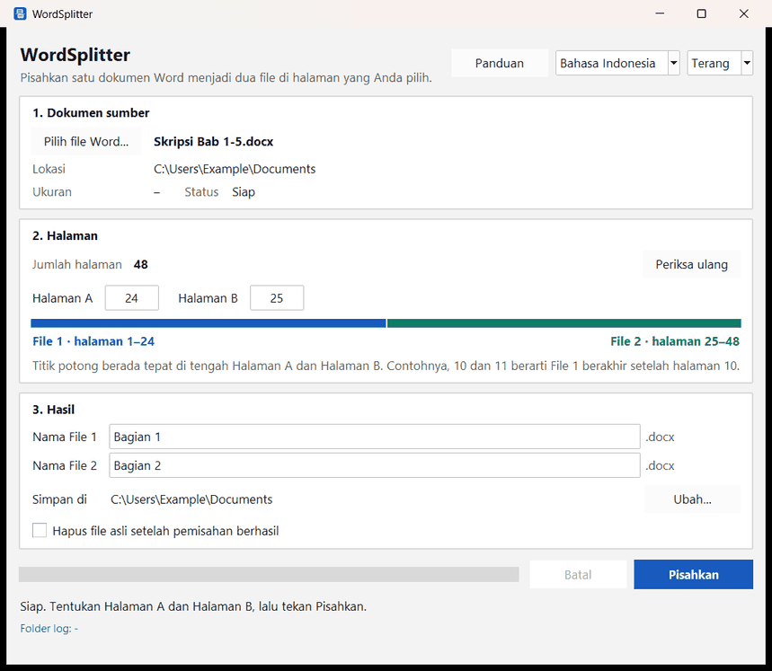
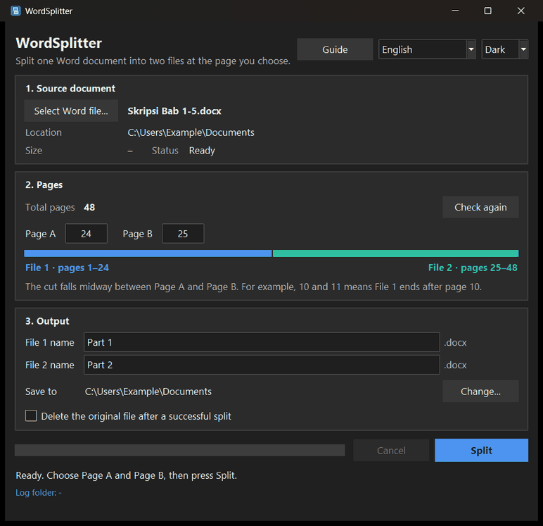
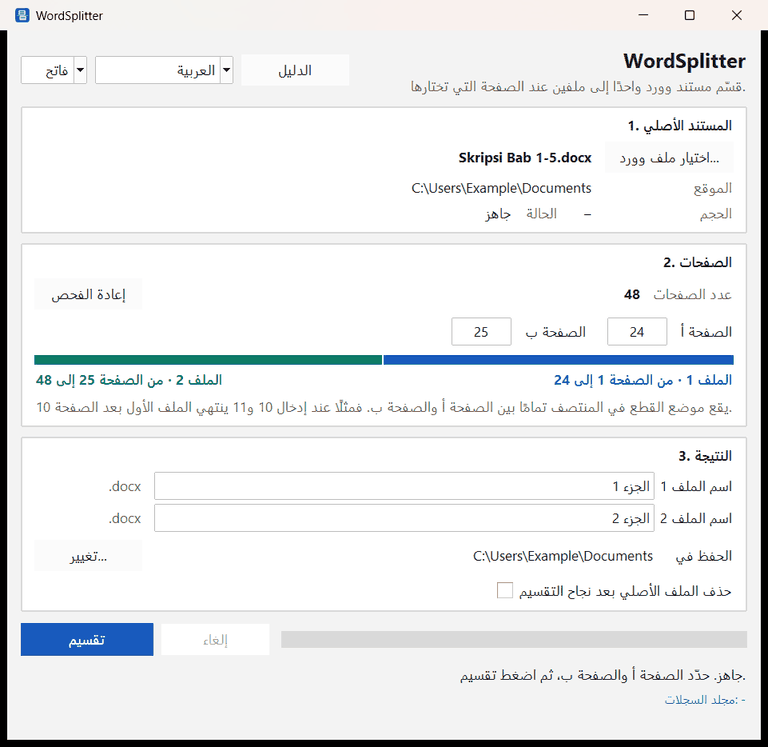
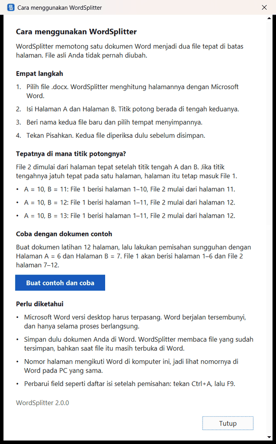

# WordSplitter

> [!IMPORTANT]
> **Tercatat resmi pada Direktorat Jenderal Kekayaan Intelektual (DJKI), Kementerian Hukum Republik Indonesia.**
> Nomor pencatatan ciptaan: **`EC002026162898`** · Pencipta dan Pemegang Hak Cipta: **Ibnu Khoirul Anwar (NuRichter)** · Tanggal pencatatan: **` 2 September 2026`**
> Verifikasi keaslian surat pencatatan: **https://hakcipta.dgip.go.id/legal/c/MDAxNDY0NzM2**

[](https://hakcipta.dgip.go.id/legal/c/MDAxNDY0NzM2)
[](LICENSE)


Aplikasi *desktop* Windows untuk memisahkan satu dokumen Microsoft Word `.docx` menjadi dua file, tepat di batas halaman yang Anda pilih.

Aplikasi ini hanya punya satu fungsi, dan fungsi itu dibuat sebenar dan seaman mungkin. Tidak ada konversi format, tidak ada penyuntingan isi, tidak ada fitur tambahan yang tidak perlu.

```
Pilih file  →  Hitung halaman  →  Halaman A & Halaman B  →  Pisahkan  →  Dua file baru
```

| Tema terang · Bahasa Indonesia | Tema gelap · English | Kanan-ke-kiri · العربية |
|---|---|---|
|  |  |  |

---

## Daftar isi

1. [Apa yang baru di versi 2.0](#1-apa-yang-baru-di-versi-20)
2. [Persyaratan sistem](#2-persyaratan-sistem)
3. [Cara memakai](#3-cara-memakai)
4. [Simulasi dengan dokumen dummy](#4-simulasi-dengan-dokumen-dummy)
5. [Di mana tepatnya titik potong?](#5-di-mana-tepatnya-titik-potong)
6. [Cara kerja di balik layar](#6-cara-kerja-di-balik-layar)
7. [Jaminan keamanan data](#7-jaminan-keamanan-data)
8. [Ketahanan terhadap kondisi nyata](#8-ketahanan-terhadap-kondisi-nyata)
9. [Ringan saat idle, cepat saat bekerja](#9-ringan-saat-idle-cepat-saat-bekerja)
10. [Bahasa dan tema](#10-bahasa-dan-tema)

---

## 1. Apa yang baru di versi 2.0

**Hasil pemisahan yang benar-benar tepat.** Versi 1.0 diuji ulang pada dokumen nyata dan ditemukan beberapa cacat. Semuanya sudah diperbaiki dan dibuktikan dengan pengujian otomatis memakai Microsoft Word sungguhan.

| Kasus | Versi 1.0 | Versi 2.0 |
|---|---|---|
| Dokumen dengan *page break* manual (`Ctrl+Enter`) | File 1 kelebihan satu halaman kosong di akhir | Jumlah halaman tepat |
| Dokumen ber-*section* (sampul, halaman romawi, bab, lampiran *landscape*) | File 1 memakai *header*, margin, dan penomoran milik *section* terakhir | Setiap bagian mempertahankan *page setup*, *header*, *footer*, dan gaya penomorannya sendiri |
| Titik potong tepat di pergantian *section* | File 1 berakhir dengan halaman kosong ber-*section* asing | Bersih, tanpa halaman tambahan |
| Titik potong di tengah tabel panjang | File 1 kelebihan halaman kosong, baris judul tabel hilang di File 2 | Baris judul yang berulang ikut terbawa ke File 2 |
| *Track Changes* aktif | Isi File 2 masih tersimpan di File 1 sebagai revisi "terhapus" | Penghapusan nyata, revisi asli milik bagian itu tetap utuh |
| Titik potong di dalam daftar isi atau daftar pustaka Mendeley/Zotero | Gagal dengan pesan `Cannot edit Range` | Berhasil; *field* yang terpotong diubah menjadi teks biasa dan Anda diberi tahu |

**Antarmuka baru dengan prinsip lama.** Tiga langkah yang sama (dokumen, halaman, hasil), ditambah:

* gambaran visual titik potong yang langsung berubah saat Anda mengetik Halaman A dan B;
* pilihan folder penyimpanan;
* **Panduan** di dalam aplikasi yang bisa membuat dokumen latihan dan langsung mensimulasikan pemisahan;
* **30 bahasa** yang ditulis seperti penutur asli, termasuk tata letak kanan-ke-kiri untuk Arab, Persia, dan Urdu;
* **2 tema**, terang dan gelap, termasuk *title bar* Windows yang ikut gelap;
* file asli yang dihapus masuk ke **Recycle Bin**, tidak langsung lenyap.

**Arsitektur baru.** Jendela aplikasi dan pekerjaan Word kini berjalan di dua proses terpisah. Hasilnya, idle hampir tidak memakai CPU, `Cancel` berhenti seketika, dan Word tidak pernah tertinggal di latar belakang. Rinciannya ada di bagian 6, 8, dan 9.

---

## 2. Persyaratan sistem

| Komponen | Persyaratan |
|---|---|
| Sistem operasi | Windows 10 atau 11, 64-bit |
| Microsoft Word | **Wajib.** Word *desktop* 2016, 2019, 2021, 2024, atau Microsoft 365, terpasang dan sudah aktif |
| Perangkat keras | Apa pun yang mampu menjalankan Word. Diuji dari laptop 1366×768 berskala 100% hingga layar 1080p berskala 125% |
| Python | Hanya untuk *developer*: 3.11 sampai 3.14. Pengguna `.exe` tidak memerlukan Python |

Word versi *web* dan versi Microsoft Store lama tidak menyediakan antarmuka otomasi, jadi tidak dapat dipakai.

**Mengapa harus Word?** Berkas `.docx` menyimpan aliran teks, bukan halaman. Letak "halaman 10 berakhir" baru diketahui saat Word menata letak dokumen dengan *font*, *printer driver*, dan opsi kompatibilitas di komputer Anda. Menebak dari jumlah paragraf, membaca penanda `lastRenderedPageBreak`, atau memakai LibreOffice menghasilkan halaman yang berbeda dengan yang Anda lihat di Word. Karena itu WordSplitter bertanya langsung kepada Word.

---

## 3. Cara memakai

1. Tekan **Pilih file Word…** dan pilih dokumen `.docx`. WordSplitter langsung menghitung halamannya dengan Word (biasanya 1–3 detik).
2. Isi **Halaman A** dan **Halaman B**. Bilah berwarna di bawahnya langsung menunjukkan halaman mana yang masuk File 1 dan File 2.
3. Beri nama kedua file. Ekstensi `.docx` ditambahkan otomatis. Tekan **Ubah…** bila ingin menyimpan di folder lain.
4. Centang **Hapus file asli** hanya bila memang diinginkan. Opsi ini mati secara *default*.
5. Tekan **Pisahkan**. Bila nama file sudah ada, Anda bisa memilih *Timpa* atau *Pakai nama lain*.
6. Setelah selesai, tekan **Buka folder** untuk langsung melihat kedua file.

Pintasan: `Ctrl+O` memilih file, `Enter` di kolom halaman atau nama memulai pemisahan, `Esc` membatalkan, `F1` membuka Panduan.

Selama proses berjalan, jendela tetap responsif. **Batal** menghentikan proses seketika, kapan pun, termasuk saat Word baru mulai dibuka. Pengecualiannya hanya pada sepersekian detik terakhir saat file hasil sedang disimpan; tahap itu sengaja diselesaikan agar tidak berhenti setengah jalan.

---

## 4. Simulasi dengan dokumen dummy

Folder [`samples/`](samples) berisi tiga dokumen dummy yang mewakili kasus nyata. Anda bisa membukanya di WordSplitter dan mengikuti skenario di bawah. Dokumen pertama juga bisa dibuat dari dalam aplikasi: buka **Panduan** lalu tekan **Buat contoh dan coba**. WordSplitter akan membuat dokumen latihan dalam bahasa antarmuka Anda dan langsung mengisi Halaman A = 6 dan Halaman B = 7.



Hasil di bawah diukur dengan Word 16 (Microsoft 365) pada Windows 11. Jumlah halaman dokumen 02 dan 03 bisa sedikit berbeda di komputer dengan *font* atau *printer driver* lain, tetapi perilakunya sama.

### 4.1 `01-dasar-12-halaman.docx` (12 halaman, setiap judul diawali *page break*)

| Halaman A | Halaman B | File 1 | File 2 | Catatan |
|---|---|---|---|---|
| 6 | 7 | halaman 1–6 (6 halaman) | halaman 7–12 (6 halaman) | Skenario latihan di Panduan |
| 6 | 8 | halaman 1–7 (7 halaman) | halaman 8–12 (5 halaman) | Titik tengah jatuh di halaman 7, jadi halaman 7 ikut File 1 |

Setiap halaman dokumen ini menuliskan "Setelah dipisahkan, halaman ini masuk ke File 1/File 2", sehingga hasilnya mudah diperiksa dengan mata.

### 4.2 `02-skripsi-section-toc-tabel.docx` (19 halaman, berbentuk skripsi)

Struktur: sampul (halaman 1, tanpa nomor) · bagian awal bernomor romawi berisi kata pengantar dan daftar isi (halaman 2–3, *header* "Bagian Awal") · Bab 1–5 bernomor arab mulai dari 1 (halaman 4–13, *header* "Isi Skripsi", ada catatan kaki) · lampiran *landscape* berisi tabel 90 baris dengan baris judul berulang (halaman 14–19, *header* "Lampiran").

| Halaman A | Halaman B | File 1 | File 2 | Yang diperiksa |
|---|---|---|---|---|
| 3 | 4 | sampul + bagian awal (3 halaman) | Bab 1 sampai lampiran (16 halaman) | File 1 tetap bernomor romawi dan ber-*header* "Bagian Awal"; File 2 diawali "BAB 1" dengan *header* "Isi Skripsi" |
| 9 | 10 | sampai Bab 3 (9 halaman) | Bab 4 sampai lampiran (10 halaman) | *Header* bab yang diwarisi dari *section* sebelumnya tetap muncul di File 2 |
| 13 | 14 | sampai Bab 5 (13 halaman) | lampiran saja (6 halaman) | File 2 tetap *landscape* |
| 16 | 17 | sampai tengah tabel (16 halaman) | sisa tabel (3 halaman) | File 2 dibuka dengan baris judul tabel "No · Responden · Skor · Keterangan" |

### 4.3 `03-lacak-perubahan.docx` (8 halaman, *Track Changes* aktif)

| Halaman A | Halaman B | File 1 | File 2 | Yang diperiksa |
|---|---|---|---|---|
| 4 | 5 | halaman 1–4 | halaman 5–8 | Isi File 2 benar-benar hilang dari File 1, bukan disimpan sebagai revisi. Dua revisi asli di halaman 1–4 tetap ada, dan setelan *Track Changes* tetap aktif di kedua file |

Semua skenario ini juga dijalankan otomatis oleh `tests/test_worker.py` dan alat laboratorium pengembang, dengan pemeriksaan jumlah halaman, *section*, *header*, orientasi, tabel, dan revisi.

---

## 5. Di mana tepatnya titik potong?

Titik potong berada di batas halaman yang paling dekat dengan titik tengah Halaman A dan Halaman B.

```
halaman_awal_File_2 = ⌊(A + B) ÷ 2⌋ + 1
File 1 = halaman 1 … halaman_awal_File_2 − 1
File 2 = halaman_awal_File_2 … halaman terakhir
```

| A | B | Titik tengah | File 1 | File 2 |
|---|---|---|---|---|
| 10 | 11 | 10,5 | 1–10 | 11–akhir |
| 10 | 12 | 11 | 1–11 | 12–akhir |
| 10 | 13 | 11,5 | 1–11 | 12–akhir |
| 1 | 2 | 1,5 | 1 | 2–akhir |

Bila titik tengah jatuh tepat pada satu halaman (A = 10, B = 12), halaman itu ikut File 1. Urutan A dan B boleh terbalik; 11 dan 10 memberi hasil yang sama dengan 10 dan 11. Angka boleh diketik dengan digit Arab, Persia, Devanagari, atau angka lebar Jepang/Tiongkok.

---

## 6. Cara kerja di balik layar

```
┌──────────────────────────────┐        JSON lewat pipa        ┌──────────────────────────────┐
│  Jendela (proses GUI)        │ ───── permintaan / batal ───▶ │  Worker (proses singkat)     │
│  Tk saja · tanpa COM · idle  │ ◀──── kemajuan / hasil ────── │  pywin32 · COM · watchdog    │
│  hampir 0 CPU                │                               │  hidup hanya selama 1 tugas  │
└──────────────────────────────┘                               └──────────────┬───────────────┘
                                                                              │ Job Object
                                                                              ▼ kill-on-close
                                                               ┌──────────────────────────────┐
                                                               │  Microsoft Word tersembunyi  │
                                                               │  hanya membuka salinan kerja │
                                                               └──────────────────────────────┘
```

**Satu exe, dua peran.** `WordSplitter.exe` membuka jendela. Untuk setiap analisis atau pemisahan, exe yang sama dijalankan lagi sebagai *worker* dengan `--worker`. Worker memakai ulang folder ekstraksi milik jendela, jadi tidak ada ekstraksi ulang. Worker bekerja, melaporkan hasil, lalu keluar. Jendela tidak pernah memuat pywin32, COM, atau Word.

**Alur satu kali pemisahan:**

1. Dokumen diperiksa tanpa Word: bisa dibaca, berupa paket `.docx` yang sehat, tidak terenkripsi, dan belum berubah sejak dianalisis (sidik jari ukuran + waktu ubah).
2. Dokumen disalin byte-demi-byte ke folder kerja pribadi dengan nama unik. **Word hanya membuka salinan ini**, tidak pernah file Anda. File asli tidak terkunci, tidak masuk daftar *Recent*, dan tidak ikut sistem pemulihan Word.
3. Satu sesi Word melakukan semuanya: menghitung halaman, mencari posisi karakter awal halaman tujuan (`GoTo`), membentuk File 1 dari dokumen yang sudah terbuka, membentuk File 2 dari pembukaan kedua, lalu membuka ulang kedua hasil untuk memastikan Word sendiri bisa membacanya.
4. Hasil dipindahkan ke folder tujuan secara transaksional (lihat bagian 7).

**Cara memotong.** Dokumen tidak pernah dibangun ulang dari teks. Setiap hasil adalah salinan utuh yang hanya kehilangan satu rentang isi, sehingga *styles*, *theme*, penomoran, tabel, gambar, *hyperlink*, *bookmark*, catatan kaki, dan *metadata* dipertahankan oleh Word sendiri. Sebelum memotong, WordSplitter:

* mematikan sementara *Track Changes* agar penghapusan nyata, lalu mengembalikan setelannya;
* membuka kunci *restrict editing* tanpa kata sandi, lalu memasangnya kembali;
* menyalin *page setup*, *header*, *footer*, dan penomoran *section* yang tersisa ke *section* terakhir, karena di Word tanda paragraf terakhir yang menentukan format *section* terakhir;
* membuat *header* yang diwarisi dari *section* sebelumnya menjadi milik sendiri sebelum *section* sebelumnya dibuang;
* memindahkan titik potong ke awal baris bila halaman dimulai di tengah baris tabel, dan mempertahankan baris judul tabel yang berulang;
* membuang sisa *page break*, *section break*, atau *column break* di ujung File 1 yang menyebabkan halaman kosong;
* bila Word menolak memotong di tengah *field* (daftar isi, daftar pustaka Zotero/Mendeley) atau *content control* terkunci, *field* itu diubah menjadi teks biasa dan Anda diberi peringatan.

---

## 7. Jaminan keamanan data

```
File asli  (hanya dibaca untuk disalin, tidak pernah dibuka Word)
   ↓
Salinan kerja dengan nama unik  →  Word menghitung dan memotong
   ↓
File 1 & File 2 sementara  →  dibuka ulang oleh Word  →  diperiksa sebagai paket .docx
   ↓
Commit transaksional ke folder tujuan
   ↓
File asli ke Recycle Bin (hanya bila diminta dan semua langkah di atas berhasil)
```

* Bila file tujuan sudah ada dan Anda memilih *Timpa*, file lama disisihkan dulu. Bila penyimpanan gagal di tengah jalan, file lama dikembalikan persis seperti semula.
* File hasil ditulis ke nama sementara, di-*flush* ke disk, baru diganti nama secara atomik. Karena disalin, bukan dipindahkan, file baru mewarisi izin folder tujuan.
* Hasil dianggap gagal bila kedua file masih memuat seluruh dokumen. Bila jumlah halaman hasil berbeda dari yang diharapkan, Anda diberi tahu.
* Bila proses dibatalkan atau gagal, folder kerja dan semua file sementara dibersihkan. Folder kerja yang tertinggal karena listrik padam dibersihkan otomatis pada pemakaian berikutnya.
* "Hapus file asli" memindahkan file ke **Recycle Bin** bila drive-nya punya Recycle Bin. Di drive jaringan atau USB, file dihapus permanen, dan hal ini disebutkan di dialog konfirmasi.
* Ruang disk diperiksa sebelum mulai, baik di folder kerja maupun di folder tujuan.

---

## 8. Ketahanan terhadap kondisi nyata

| Kondisi | Yang terjadi |
|---|---|
| Dokumen sedang terbuka dan sedang diedit di Word milik Anda | Tetap bisa diproses. WordSplitter membaca versi yang terakhir disimpan |
| Word menampilkan dialog yang menunggu jawaban (misalnya "File In Use", pemulihan dokumen, aktivasi) | *Watchdog* mendeteksi jendela dialog pada instance Word milik WordSplitter dalam ±1,4 detik, menutup Word itu, lalu menampilkan judul dialog dalam pesan yang jelas. Tidak ada lagi aplikasi yang "hang" |
| Word sibuk dan menolak panggilan (`RPC_E_CALL_REJECTED`) | Panggilan diulang otomatis hingga 2 menit |
| Cache `gen_py` pywin32 rusak di komputer pengguna | Tidak berpengaruh, karena semua panggilan memakai *late binding* |
| Pengguna menekan **Batal**, bahkan saat Word baru mulai | Word dihentikan dalam waktu kurang dari satu detik (terukur 0,04 detik di tengah pemisahan, 0,5 detik saat Word baru mulai), semua file sementara dibersihkan |
| Jendela WordSplitter ditutup paksa lewat Task Manager atau komputer *crash* | Pipa ke worker tertutup, worker menghentikan Word-nya sendiri. Word juga terikat *Job Object* sehingga ikut mati bila worker mati |
| Worker sendiri mogok | Jendela menampilkan pesan yang jelas, file asli tidak tersentuh |
| Dokumen berkata sandi atau `.doc` lama yang diganti ekstensinya | Dikenali dari tanda tangan berkas sebelum Word dibuka |
| Dokumen rusak | Dikenali dari pemeriksaan paket ZIP dan CRC, atau ditolak Word dengan pesan yang jelas |
| Dokumen berubah setelah dianalisis | Dianalisis ulang otomatis, Anda diminta memastikan Halaman A dan B |
| Folder tujuan tidak bisa ditulis, termasuk karena *Controlled folder access* | Dicek sebelum mulai, dengan saran tindakan |
| Path terlalu panjang untuk Word | Word hanya membuka salinan kerja ber-path pendek; nama tujuan dibatasi agar tetap bisa dibuka Word |
| Opsi Word milik Anda | Opsi yang diubah selama otomasi dikembalikan sebelum Word ditutup; *Normal.dotm* tidak pernah disimpan |
| Layar kecil (1366×768 pada 100%) | Mode ringkas otomatis agar seluruh jendela tetap terlihat |

---

## 9. Ringan saat idle, cepat saat bekerja

Diukur pada Windows 11, Python 3.14, setelah jendela tenang 6 detik. CPU diukur dengan `QueryProcessCycleTime` (median 5 kali), memori dengan *private bytes*.

| Kondisi idle | v1.0 | v2.0 |
|---|---|---|
| Siklus CPU per 15 detik | 65,1 juta | **2,4 juta** (setara jendela Tk kosong, ±27× lebih hemat) |
| *Timer* yang berjalan | polling 10× per detik | **tidak ada** |
| Memori pribadi proses jendela | 22,4 MB | 24,0 MB |
| Setelah satu kali pemisahan | pywin32 dan COM tetap termuat di proses jendela | proses jendela tetap bersih; worker sudah keluar |
| Instance Word di latar belakang | ditutup setelah tugas | ditutup setelah tugas, dijamin oleh Job Object |

Pada build `.exe` *onefile*, ada satu proses *bootloader* kecil tambahan dari PyInstaller (total memori pribadi sekitar 27 MB).

Saat bekerja, waktu yang dirasakan dipangkas dengan beberapa cara:

* Hasil dikirim ke jendela segera setelah file tersimpan. Penutupan Word, yang butuh sekitar 2,6 detik, berlangsung di latar belakang.
* File 1 dibentuk langsung dari dokumen yang sudah terbuka untuk analisis, sehingga satu kali pembukaan dan penataan letak bisa dihemat.
* Pemeriksaan ulang hasil hanya membuka file, tidak menata letak ulang seluruh dokumen.

Pada dokumen contoh, analisis memakan 0,9–2,5 detik dan pemisahan 1,3–4,3 detik.

---

## 10. Bahasa dan tema

Antarmuka tersedia dalam 30 bahasa. Bahasa awal mengikuti bahasa tampilan Windows, dan bisa diganti kapan saja dari menu di kanan atas. Teks ditulis seperti penutur asli, dengan istilah yang sama dengan Windows dan Office di bahasa tersebut.

English · Bahasa Indonesia · Bahasa Melayu · Basa Jawa · Deutsch · Español · Filipino · Français · Italiano · Kiswahili · Nederlands · Polski · Português (Brasil) · Tiếng Việt · Türkçe · Русский · Українська · العربية · فارسی · اردو · हिन्दी · मराठी · বাংলা · தமிழ் · తెలుగు · ไทย · 简体中文 · 繁體中文 · 日本語 · 한국어

* Setiap bahasa memakai *font* antarmuka Windows yang paling cocok untuk aksaranya: Segoe UI, Nirmala UI, Leelawadee UI, Microsoft YaHei UI, Microsoft JhengHei UI, Yu Gothic UI, atau Malgun Gothic.
* Arab, Persia, dan Urdu memakai tata letak cermin kanan-ke-kiri. Kalimatnya disusun agar tetap terbaca benar di mesin teks Tk, misalnya rentang halaman ditulis "من الصفحة 1 إلى 24", bukan "1-24".
* Satuan ukuran dan tanda desimal mengikuti bahasa, misalnya `1,50 Mo` dalam bahasa Prancis.
* Dokumen latihan di Panduan dibuat dalam bahasa yang sedang dipakai, termasuk arah teks kanan-ke-kiri.

Tema **Terang** dan **Gelap** tersedia. Pilihan awal mengikuti setelan Windows. Pilihan bahasa dan tema disimpan di `%LOCALAPPDATA%\WordSplitter\settings.json`.

---

## Lisensi

[MIT](LICENSE) © 2026 Ibnu Khoirul Anwar (NuRichter)
